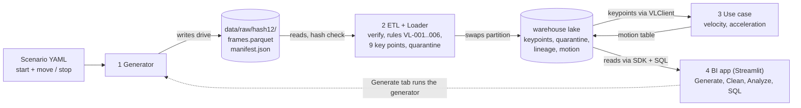
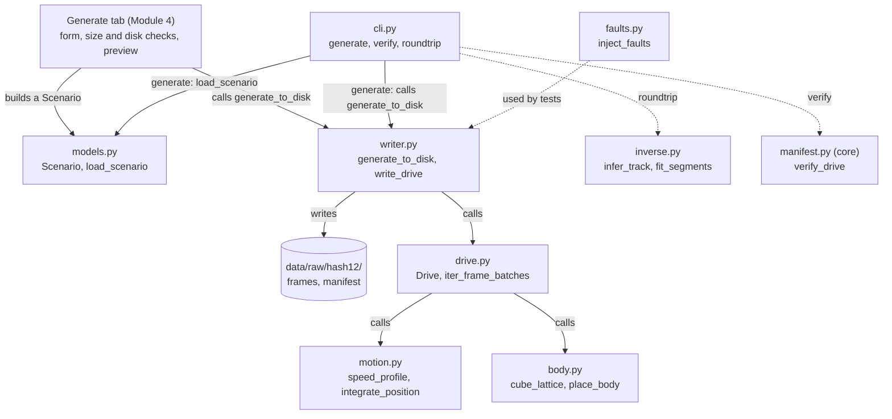
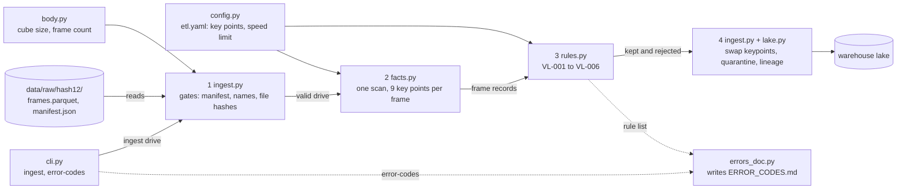
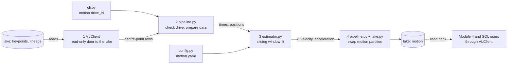
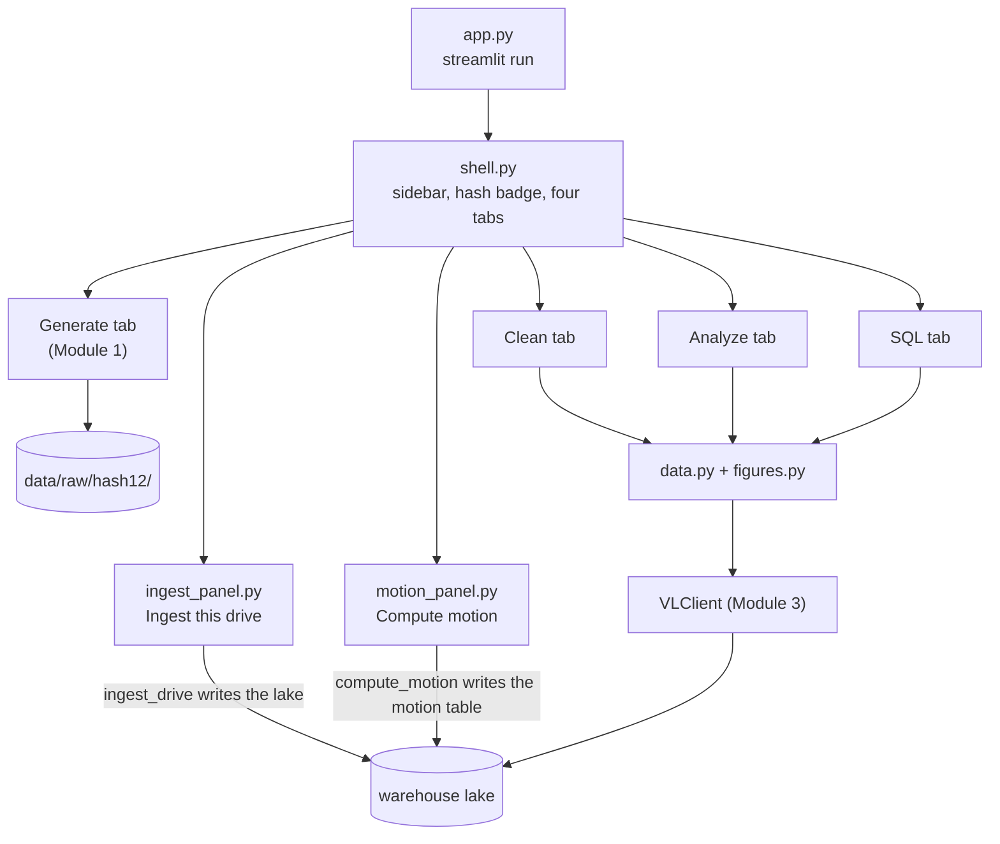

# Vehicle Location Data Product: Engineering Report

From a mock vehicle-location signal to queryable velocity and acceleration. Four modules, each shown as a black box first, then opened one module at a time. Source state read on 27 Oct 2026. A PDF version with the same content is `ENGINEERING_REPORT.pdf`.

## Module status

| Module | State | Where |
|---|---|---|
| 1 Generator | Built and in main | change 608136a |
| 2 ETL + Loader | Built and in main | merged as a0c4756 |
| 3 Use case | Built and in main | merged as e896227 |
| 4 BI | Built and in main | merged as 95a9f6f |

## What the project does

The product turns a vehicle-location signal into motion data that people can query. The signal describes the host vehicle as a 1 m cube of 1,000,000 points (100 per side, 1 cm apart), captured 16 times a second. No real recordings exist for the exercise, so the project builds its own source and everything after it.

Four modules do the work. Each one reads what the previous one wrote and passes on a documented set of files.

1. **Generator.** Turns a short scenario (a start position and a list of move and stop segments) into a drive: a point cloud for every frame and a manifest with the hash of each file.
2. **ETL + Loader.** Checks the hashes, tests every frame against six error codes (VL-001 to VL-006), keeps 9 key points per frame (8 corners and the centre), and writes them to a Parquet lake. Bad frames go to a quarantine table.
3. **Use case.** Computes the velocity and acceleration of the vehicle from the centre point, and stores them as a motion table.
4. **BI.** One Streamlit app with four tabs: generate a drive, ingest it, compute its motion, inspect its data quality, see the motion, and run SQL on the lake.

The implemented use case is ego-motion extraction: the velocity and acceleration of a vehicle that drives forwards, drives backwards, stops, and changes speed. Five more use cases are written up in `docs/USE_CASES.md` and not built.

## Engineering concepts and assumptions

Tags: **decision** a choice we made and can defend, **assumption** something we took as given, **measured** a number from a real run, **computed** a number worked out by arithmetic.

### How the system is cut

- **One-way dependencies** (decision). A module uses only the shared core and the modules before it. Each can be tested alone.
- **Files are the contract** (decision). Module 1 hands over a drive folder (manifest schema version 2). Module 2 hands over lake tables. Each handover is a documented Parquet schema, so separate sessions built the modules in parallel.
- **Python SDK and SQL, no web service** (decision). VLClient reads lake tables as Arrow and runs SQL with DuckDB. A REST API is listed as coming soon.

### Data and identity

- **Scenario hash names the drive** (decision). SHA-256 of the canonical scenario, including cube size and density. The first 12 hex characters are the folder name. The manifest keeps all 64 and the hash of every file. Same scenario, same folder.
- **Re-ingest is safe to repeat** (decision). The lake is Hive-style Parquet, partitioned by drive. A drive is replaced by writing a new folder and renaming it into place. That is two renames, not one atomic step, and the docs say so.

### Assumptions about the signal

- **Straight line along x** (assumption). Signed speed, no turning, y and z constant. The shape of a cube shows no orientation, so yaw could not be read back from the points.
- **No sensor noise** (assumption). The only error is rounding the points to whole centimetres.
- **Fixed point order** (assumption). Module 2 picks corners and centre by index. The corner spacing also serves as a rigid-shape check (VL-004).
- **Full density** (decision). 1,000,000 points per frame is 12,000,000 bytes (computed). Frames are written in batches of about 50 with zstd. The 1,000-frame demo is 287,134,433 bytes with zstd and 4,024,944,648 with snappy (measured). A scenario may have at most 2,000 frames.

### Algorithm and verification

- **Window fit, not frame differences** (computed). Positions are rounded to whole centimetres, so each can be off by 0.5 cm. A second difference at 16 fps multiplies that by 16 x 16 = 256, so two such errors can swing the acceleration by up to 512 cm/s², while the scenarios accelerate at about 100 cm/s². Velocity and acceleration therefore come from a sliding polynomial fit (16 frames, order 2).
- **The generator is tested by its inverse** (decision). Property tests check that recovering a scenario from generated frames gives the scenario back, within measured tolerances.
- **Quality gates** (measured). pytest with hypothesis, ruff, mypy, Python 3.11. Module 1: 329 tests passed and 1 skipped on 26 Oct 2026; coverage was 100% at its last review gate, not re-run that day. Every assumption has a numbered entry in `docs/ASSUMPTIONS.md`.

## System flow

Inputs and outputs of the four modules. Each module is a black box here; a deeper diagram follows per module.



Data moves from the scenario to the drive folder, to the lake tables, to the motion table. Cylinders are stored files, boxes are code. Dashed arrows are calls. Keypoints, quarantine and lineage are written by Module 2; motion is written by Module 3. The Generate tab is Module 1's screen, hosted inside the Module 4 app. All modules use the shared core: config, hashing, Arrow schemas, manifest, lake.

## Known limits and open items

| Scope | Item | Detail | Source |
|---|---|---|---|
| Module 1 | **No rotation** | A real vehicle rotates. Reading its orientation needs a non-symmetric body or tracked points. | ARCHITECTURE, limits |
| Module 1 | **The folder swap is not atomic** | Replacing a drive is two renames. A crash between them can leave a .old-* folder, and the swap is not safe for concurrent writers. | ASSUMPTIONS A49 |
| Module 1 | **The hash covers scenario and body, not fps** | A different fps lands in the same 12-character folder and replaces the earlier drive. | ASSUMPTIONS A52 |
| Module 1 | **File hashes depend on the pyarrow version** | The same scenario gives the same bytes only on the same pyarrow version. | ARCHITECTURE, limits |
| Module 1 | **Fault injection copies every frame into Python** | Fine for small drives. A 1,000-frame full-density drive would be about 12 GB of Python objects (computed), so faults are tested on small lattices. | follow-up TASK-6-1 |
| Module 1 | **A Windows junction at a drive folder** | The writer and the Generate tab treat a junction like a normal folder and refuse only symlinks. Kept on purpose after review (decision of 26 Oct 2026). | follow-up TASK-7-1-3 |
| Whole project | **Plain Parquet has no table layer** | No atomic commit across files, no schema-evolution tracking, no time travel. | ARCHITECTURE, limits |
| Whole project | **Request from Module 2, not done** | Cap the size of manifest.json, refuse symlinked files, add a drive-id validator in core. Low priority; left open on purpose. | follow-up core-hardening-1 |

## File structure

Every tracked source, config, doc and tool file. Every tracked source, config, doc and tool file of the four modules, as in main on 27 Oct 2026. The Owner column says which module a file belongs to.

### Project root (`/`)

| File | Owner | What it does |
|---|---|---|
| `.streamlit/config.toml` | Module 4 | Pins the Streamlit server to 127.0.0.1, because the SQL tab has no login. |
| `.gitignore` | Whole project | Keeps the assignment PDF, generated data (data/, warehouse/, *.parquet), local environments and LLM-usage logs out of git. |
| `README.md` | Whole project | Project readme. Holds only the title so far. |
| `pyproject.toml` | Whole project | Package definition (vl-data, Python 3.11+): dependencies and settings for pytest, ruff and mypy. |

### config/ (`config/`)

| File | Owner | What it does |
|---|---|---|
| `default.yaml` | Shared core | Shared defaults: 16 fps, raw data folder, cube of 100 cm with 100 points per axis, round-trip tolerances of the generator. |
| `etl.yaml` | Module 2 | Loader settings: accepted schema versions, read chunk size, size limits, lake folder (VL_LAKE_DIR overrides), top speed of 9,000 cm/s, keypoint list. |
| `motion.yaml` | Module 3 | Motion estimator settings: 16-frame window, polynomial order 2, minimum points and gap limits. |

### docs/ (`docs/`)

| File | Owner | What it does |
|---|---|---|
| `architecture_context.txt` | Whole project | The agreed design decisions and the checklist of what the assignment asks for. The base of every module plan. |
| `ARCHITECTURE.md` | Whole project | Design document: one section per module, with the data flow and the reason for each technology choice. |
| `ASSUMPTIONS.md` | Whole project | Numbered log of every assumption and decision, with the reason and the consequence. |
| `ENGINEERING_REPORT.pdf` | Whole project | This report as a PDF: 15 portrait A4 pages, with the diagrams turned sideways at the end. |
| `ENGINEERING_REPORT.md` | Whole project | This report as Markdown, with Mermaid diagrams that GitHub draws. |
| `ERROR_CODES.md` | Module 2 | List of error codes VL-001 to VL-006. Generated from the rule registry; a test fails if the file drifts. |
| `RELEASE_NOTES.md` | Whole project | Product description, usage with commands, known issues, coming soon. |
| `SUPPORTING_DOCUMENTATION.md` | Whole project | Generated single file: error codes, architecture and release notes in the order the assignment lists them. |
| `USE_CASES.md` | Module 3 | Six candidate use cases for the signal. One (ego-motion) is implemented. |
| `USE_CASE_ERRORS.md` | Module 3 | Named failures of the use case (MotionError, SQL refusals) and what to do about each. |

### tools/ (`tools/`)

| File | Owner | What it does |
|---|---|---|
| `build_supporting_docs.py` | Whole project | Joins ERROR_CODES, ARCHITECTURE and RELEASE_NOTES into SUPPORTING_DOCUMENTATION.md. |
| `motion_sweep.py` | Module 3 | Measures the motion estimator on generated drives to pick the window and order, and writes config/motion.yaml. Under review. |

### Package entry (`src/vl_data/`)

| File | Owner | What it does |
|---|---|---|
| `__init__.py` | Whole project | Package marker. |
| `__main__.py` | Whole project | Entry point for python -m vl_data. |
| `cli.py` | Whole project | Root command-line app (Typer). Mounts the commands of each module. |

### Shared core (`src/vl_data/core/`)

| File | Owner | What it does |
|---|---|---|
| `config.py` | Shared core | Configuration models and the YAML loader (cm, cm/s, frames). Checked on load. |
| `hashing.py` | Shared core | Canonical JSON and SHA-256 helpers. |
| `schemas.py` | Shared core | Arrow schemas of the drive files and the byte encoding of a point cloud. |
| `manifest.py` | Shared core | Builds, writes, reads and verifies manifest.json (scenario hash plus the hash of every file). |
| `lake.py` | Module 2 | Hive-style Parquet lake: read, list, and replace the partition of one drive. |
| `lake_schemas.py` | Module 2 | Arrow schemas of the lake tables: keypoints, quarantine, lineage. |

### Module 1: generator (`src/vl_data/generator/`)

| File | Owner | What it does |
|---|---|---|
| `models.py` | Module 1 | Scenario model: start state plus a list of move and stop segments. Strict validation. |
| `body.py` | Module 1 | The 1 m cube as a point lattice, and the indices of its corners. |
| `motion.py` | Module 1 | Position, speed and acceleration of every frame along x, from the segments. |
| `drive.py` | Module 1 | In-memory drive: the frames table. |
| `writer.py` | Module 1 | Writes a drive to disk in batches (zstd), checks it, then swaps the folder into place. |
| `faults.py` | Module 1 | Fault injection: drop frames, corrupt a frame, shift timestamps. Used to test the ETL. |
| `inverse.py` | Module 1 | Inverse of the generator: recovers track and segments from frames. Used by roundtrip. |
| `cli.py` | Module 1 | Commands generate, verify and roundtrip. |
| `scenarios/demo.yaml` | Module 1 | The 1,000-frame demo scenario (hash bf394b9bfb42). |
| `ui/generate_tab.py` | Module 1 | Generate tab: start form, segment table, speed preview, Generate button with size warning and disk-space check. |
| `ui/generate_app.py` | Module 1 | Standalone runner for the Generate tab (streamlit run). |

### Module 2: ETL and loader (`src/vl_data/etl/`)

| File | Owner | What it does |
|---|---|---|
| `config.py` | Module 2 | Loader configuration models and loader for etl.yaml. |
| `body.py` | Module 2 | Reads the cube geometry from the manifest of a drive. |
| `keypoints.py` | Module 2 | Picks the 8 corners and the centre of the cube from a point cloud, by index. |
| `facts.py` | Module 2 | The single pass over the frames: one small fact row and the keypoints of each frame. |
| `rules.py` | Module 2 | Rule registry VL-001 to VL-006 and the runner that applies it. |
| `ingest.py` | Module 2 | Ingests one drive: verify hashes, validate, reduce to keypoints, swap the tables into the lake. |
| `errors_doc.py` | Module 2 | Builds docs/ERROR_CODES.md from the rule registry. |
| `cli.py` | Module 2 | Commands ingest and error-codes. |

### Module 3: read API and use case (`src/vl_data/sdk/ and src/vl_data/usecase/`)

| File | Owner | What it does |
|---|---|---|
| `sdk/client.py` | Module 3 | VLClient: read-only access to the lake tables as Arrow tables, plus SQL (DuckDB). |
| `usecase/config.py` | Module 3 | Models of motion.yaml. |
| `usecase/estimator.py` | Module 3 | Sliding-window polynomial fit that gives velocity and acceleration from positions. |
| `usecase/pipeline.py` | Module 3 | Computes per-frame motion of the centre point and stores the motion table in the lake. |
| `usecase/cli.py` | Module 3 | Command motion. |

### Module 4: BI app (`src/vl_data/bi/`)

| File | Owner | What it does |
|---|---|---|
| `data.py` | Module 4 | Data layer: drive list, quality numbers, commands and queries. No Streamlit. |
| `figures.py` | Module 4 | Plotly figures. |
| `lake_lock.py` | Module 4 | One in-process lock, shared by the Ingest and Compute motion buttons, so two writes to the lake never run at once in the app. |
| `motion_panel.py` | Module 4 | Motion panel of the Analyze tab: computes or recomputes the motion table of a drive on a click, through compute_motion. |
| `ingest_panel.py` | Module 4 | Ingest panel: lists raw drive folders and ingests one drive per click through ingest_drive. One of the app's two writes to the lake. |
| `clean_tab.py` | Module 4 | Clean tab: quality of one drive, kept and quarantined frames by error code. Also shows the Ingest panel. |
| `analyze_tab.py` | Module 4 | Analyze tab: the stored position, velocity and acceleration against time, and the Compute and Recompute motion buttons. |
| `sql_tab.py` | Module 4 | SQL tab: one read-only SELECT over the lake views, example queries, 10,000-row display cap. |
| `shell.py` | Module 4 | App shell: drive selector in the sidebar, four tabs, scenario-hash badge. |
| `app.py` | Module 4 | Runner: python -m streamlit run src/vl_data/bi/app.py. |

### Tests (`tests/`)

| File | Owner | What it does |
|---|---|---|
| `conftest.py, test_cli.py` | Whole project | Shared fixtures and tests of the root command-line app. |
| `core/ (5 test files)` | Shared core | Config, hashing, schemas, manifest, body limits. |
| `generator/ (9 test files)` | Module 1 | Scenario model, body, motion, writer and full density, faults, inverse and round trip, CLI, Generate tab. |
| `etl/ (9 test files)` | Module 2 | Config, body, keypoints, facts, each rule, ingest, error-code document, CLI, end to end. |
| `sdk/ and usecase/ test files` | Module 3 | VLClient; config, estimator, pipeline, motion sweep, CLI, end to end. |
| `bi/ (8 test files)` | Module 4 | Data layer, figures, SQL tab, tabs, shell, ingest panel, motion panel, and a check that the app has no evaluation. |

Not listed: generated data (`data/`, `warehouse/`), the assignment PDF and the local LLM-usage files. All are git-ignored on purpose.

# Module 1: Generator

Builds the mock source. Given a scenario, it produces a drive: the full point cloud of a moving 1 m cube for every frame, and a manifest that lets anyone check the files. It does not read any other module's data. The other modules treat it as a black box that writes one folder.

| | |
|---|---|
| **In** | A scenario YAML: a start state (x, y, z in cm, speed in cm/s) and a list of move and stop segments. Settings from `config/default.yaml`: 16 fps, cube of 100 cm, 100 points per axis. |
| **Out** | A drive folder `data/raw/<hash12>/`: `frames.parquet` (one row per frame, 1,000,000 points in one binary column), `manifest.json` (scenario, cube, fps, counts, schema version 2, hash and size of each file). |
| **Used by** | Module 2 reads the frames and the manifest, and uses the fault injector in its tests. Module 4 hosts the Generate tab. |

## Structure



Shared core used by all of the above: `config.py` (Config, load_config), `hashing.py` (drive_hash, canonical_json), `schemas.py` (FRAMES_SCHEMA, encode_points), `manifest.py` (build_manifest, verify_drive). `drive.py` uses hashing and schemas; `writer.py` builds and verifies the manifest. The command line and the Generate tab both write through `generate_to_disk`. The command line also runs the inverse for `roundtrip` and the manifest check for `verify`; starting a scenario from the command line (`generate`) has fewer steps than from the Generate tab: the tab also checks the size and hash, skips a drive that already exists, checks the free disk space and warns about the size before it writes, and draws a speed preview with `motion.py`. The command line does none of these; it loads the file and writes. `write_drive`, the other function in `writer.py`, is used by tests and for faulty drives; neither the command line nor the tab calls it.

## How a drive is made

1. **Load and validate the scenario.** A YAML file with a start state and a list of move and stop segments. A stop needs the vehicle at rest, durations must be whole frames, and a scenario has at most 2,000 frames.
2. **Hash it.** SHA-256 of the canonical JSON of the scenario and the body (size and points per axis). The first 12 hex characters name the drive folder.
3. **Build the motion.** A straight-line ramp of speed inside each segment, integrated into a position per frame.
4. **Build the frames.** The 100 x 100 x 100 lattice, shifted by the rounded position, in batches of 50 frames so memory stays near one batch.
5. **Write and check.** The frames go to a temporary folder, the manifest is written last, the folder is swapped into place, and the drive is verified.

## Fault injection

The generator can damage a drive on purpose so that Module 2 can be tested against known errors. `inject_faults` returns a new drive and a count per error code. Only the frames table changes; the scenario hash is copied unchanged. A faulty drive still passes `verify_drive`, because its manifest is built from the faulty file.

| Fault | Triggers | What it does to the frames table |
|---|---|---|
| `DropFrame` | `VL-001` | Deletes that frame's row. Other frame ids are not renumbered. |
| `ShiftTimestamp` | `VL-002` | Adds a shift to one timestamp. The shift must be smaller than one frame interval. |
| `DuplicateFrame` | `VL-003` | Inserts a copy of the row right after the original. |
| `CorruptPoints` | `VL-004` | Removes the last point (12 bytes) from one frame. |
| `BreakSchema` | `VL-005` | Renames the column points to pts. |
| `Teleport` | `VL-006` | Adds a distance to the x coordinate of every point of one frame. |

## Design choices

| Decision | Choice | Why | Alternatives |
|---|---|---|---|
| Motion model | Straight line along x, signed speed, no rotation | A cube's orientation cannot be read from its points. | Planar motion; full rotation with a non-symmetric body |
| Body | 1 m cube, 100 x 100 x 100 = 1,000,000 points | Matches the example density of the assignment, which allows fewer frames but not thinner ones. | A 10 x 10 x 10 sample (the earlier choice); a car-sized box |
| Raw file format | Parquet via PyArrow, one row per frame | Columnar, compact, readable by every tool. | One row per point; CSV; HDF5 |
| Hashing | SHA-256 over canonical JSON (scenario) and file bytes (files) | Standard and checkable with common tools. | Content hashes; UUIDs |
| Idempotent writes | Write to a temporary folder, then swap the drive folder | Re-running never duplicates; a crash never loses the old data. | Blind append; upsert |
| Scenario validation | pydantic models and a YAML loader | Typed models with clear errors; bad values fail early. | Dataclasses with hand checks; environment variables only |

## Key figures

| Figure | Value | Label | Note |
|---|---|---|---|
| Points per frame | 1,000,000 | computed | 100 x 100 x 100 |
| Bytes per frame | 12,000,000 | computed | 3 coordinates x 4 bytes x 1,000,000 |
| Demo frames.parquet | 287,134,433 bytes | measured | 1,000 frames, zstd. With snappy: 4,024,944,648 bytes |
| generate command, demo | 81 s | measured | 24 Oct 2026, including verification |
| Peak working set | 2,859 MiB | measured | scratch script with the same 50-frame batching |
| Frame cap per scenario | 2,000 | decision | about 24 GB raw (computed) |
| Demo drive folder | bf394b9bfb42 | measured | first 12 hex of the drive hash |
| Module 1 tests | 329 passed, 1 skipped | measured | run on 26 Oct 2026 on main; the skipped test needs a Windows symlink privilege |

## Limits of this module

- **No rotation.** A real vehicle rotates. Reading its orientation needs a non-symmetric body or tracked points. (Source: ARCHITECTURE, limits)
- **The folder swap is not atomic.** Replacing a drive is two renames. A crash between them can leave a .old-* folder, and the swap is not safe for concurrent writers. (Source: ASSUMPTIONS A49)
- **The hash covers scenario and body, not fps.** A different fps lands in the same 12-character folder and replaces the earlier drive. (Source: ASSUMPTIONS A52)
- **File hashes depend on the pyarrow version.** The same scenario gives the same bytes only on the same pyarrow version. (Source: ARCHITECTURE, limits)
- **Fault injection copies every frame into Python.** Fine for small drives. A 1,000-frame full-density drive would be about 12 GB of Python objects (computed), so faults are tested on small lattices. (Source: follow-up TASK-6-1)
- **A Windows junction at a drive folder.** The writer and the Generate tab treat a junction like a normal folder and refuse only symlinks. Kept on purpose after review (decision of 26 Oct 2026). (Source: follow-up TASK-7-1-3)

# Module 2: ETL and Loader

Takes the drive folder Module 1 wrote and turns it into clean, queryable tables. It verifies every file, tests each frame against six error codes, keeps nine key points per frame, and replaces the drive's rows in a Parquet lake. Running it twice gives the same result.

| | |
|---|---|
| **In** | A drive folder `data/raw//` with `frames.parquet` and `manifest.json`. Settings from `config/etl.yaml`: the nine key points, the speed limit of 9,000 cm/s, the read chunk size. |
| **Out** | Three lake tables, one folder per drive. `keypoints`: frame, timestamp, key point name, x, y, z. `quarantine`: rejected frames or problems, with an error code and a message. `lineage`: one row per drive with its status (ok or rejected), counts of frames expected, in, kept, rejected and missing, and the hash of the frames file. |
| **Used by** | Module 3 reads the keypoints and lineage through VLClient. Module 4 reads quarantine and lineage for the Clean tab, queries all of them in the SQL tab, and starts the ingest from a button. |

## Structure



The numbered boxes are the main line: (1) check the drive and its hashes, (2) scan the frames once and pick the key points, (3) apply the rules, (4) swap three tables into the lake. body.py and config.py feed the steps with the cube size and the settings. The command line starts ingest, and error-codes asks errors_doc.py to write the error-code document from the rule list.

## How a drive is ingested

1. **Gates, cheapest first.** The folder name must be a valid drive id. The manifest must read, its folder name must equal the first 12 hex characters of the scenario hash, the schema version must be supported, and the frame rate must divide a second. Only then is every file hash checked, the slow step. Any failure rejects the whole drive before a frame is read.
2. **Schema gate.** Open frames.parquet, refuse any row group above the size cap, and compare the columns with the agreed frames schema (VL-005).
3. **One scan.** Read the frames file once, in chunks. For each frame keep a small record: frame number, timestamp, payload size, payload hash, whether the points form the expected cube, and the centre. For each valid frame also pick the 9 key points, so the file is never read twice.
4. **Rules.** Run VL-001 to VL-004 on the records. Run VL-006 only on frames that passed those, starting from a trusted frame so one teleported frame cannot poison the rest.
5. **Reduce.** Keep the key-point rows of the accepted frames, sorted by frame number and then by the key-point list, and write them as one batch. The file bytes do not depend on the chunk size.
6. **Write.** Write each table's new partition aside, then swap it in for the old one: keypoints, quarantine, then lineage. Lineage goes last and acts as the commit marker. A rejected drive drops its keypoints and gets a quarantine row and a lineage row with status rejected.

## Error codes

| Code | Name | What it means |
|---|---|---|
| `VL-001` | Missing frame | A frame number between 0 and the expected count minus 1 has no row. One quarantine row per missing number. |
| `VL-002` | Timestamp gap | The timestamp is not the frame number times the frame interval (62,500,000 ns at 16 fps). |
| `VL-003` | Duplicate frame | A frame number appears twice. Identical copies keep the first; differing copies are all quarantined. |
| `VL-004` | Corrupt point cloud | The payload is not a multiple of 12 bytes, does not hold the drive's point count, or a point is more than rounding away from the expected cube. |
| `VL-005` | Schema mismatch | The frames file's columns or types differ from the agreed schema. Rejects the whole drive. |
| `VL-006` | Impossible motion | The centre is farther from the last accepted frame than 9,000 cm/s allows (about 564.5 cm per frame, with a 2 cm margin). |
| `INTEGRITY` | Not a frame error | A changed, missing or extra file, an unreadable manifest, or a wrong folder name. Written as a drive-level quarantine row; the drive is marked rejected in lineage. |

## Design choices

| Decision | Choice | Why | Alternatives |
|---|---|---|---|
| Lake format | Plain Parquet in Hive-style folders, behind one class | Nothing to run or administer. | Apache Iceberg; Delta Lake |
| ETL engine | pandas and numpy | The data is small and the code is clear. | Polars; Spark |
| Idempotent writes | Write each partition aside, then swap it in | Re-running never duplicates rows; a crash never loses the old data. | Blind append; upsert |
| Validation | A rule registry with error codes | Explicit, testable, and the same list generates the error-code document. | Great Expectations; pandera |
| Key points | 8 corners and the centre, picked by lattice index | The corner spacing doubles as a rigid-shape check (VL-004). | Track one reference point; keep every point |

## Key figures

Reported numbers come from the other sessions' documents and were not re-run for this report.

| Figure | Value | Label | Note |
|---|---|---|---|
| Key points kept per frame | 9 | decision | 8 corners and the centre |
| Speed limit for VL-006 | 9,000 cm/s | decision | a Tesla's top speed, 322 km/h, rounded up (config/etl.yaml) |
| Demo drive on a small test body | 1,000 of 1,000 frames kept, 9,000 key-point rows | measured | checked by a test, from the Module 2 documents |
| Ingest of one full-density drive | about 45 to 92 s | measured | 45 and 56 s reported by Modules 2 and 3 (25 Oct); 91.5 s in a clean-clone run on 27 Oct; depends on the machine load |

## Limits of this module

- **The three table swaps are not one atomic step.** A crash after the keypoints swap and before the lineage swap leaves new keypoints next to the old lineage row. Ingesting the drive again fixes it. (Source: Module 2 ARCHITECTURE)
- **VL-004 misses one small change.** A single point moved by exactly 1 cm is not caught, because the check allows up to 1 cm of rounding. (Source: Module 2 ARCHITECTURE)
- **The speed check uses position only.** Per-frame acceleration is too noisy to test, so VL-006 limits the distance per frame, not the acceleration. (Source: Module 2 ARCHITECTURE)

# Module 3: Use case

The use case: the velocity and acceleration of the vehicle. It reads the centre point of every frame from the lake, fits a sliding window on the real timestamps, and stores the result as a motion table. It also owns VLClient, the read-only way into the lake that Module 4 uses too.

| | |
|---|---|
| **In** | The lake tables `keypoints` and `lineage`, read through VLClient, and `config/motion.yaml`: a window of 16 frames, polynomial order 2, at least 9 valid points in a window, gaps up to 4 frames. |
| **Out** | The `motion` table, one row per frame: frame, timestamp, position x, velocity, acceleration (null where the window is too sparse) and the number of points in the window. One partition per drive. |
| **Used by** | Module 4 draws the table in the Analyze tab, queries it in the SQL tab, and starts the computation from a button. Anyone can query it with SQL through VLClient. |

## Structure



The numbered boxes are the main line: (1) VLClient reads the centre-point rows, (2) the pipeline checks the drive and prepares the data, (3) the estimator fits the sliding window, (4) the motion table is swapped into the lake. The settings come from config/motion.yaml.

## How motion is computed

1. **Check the drive.** The drive must have exactly one lineage row, and its status must be ok. Otherwise the command stops with a named error and writes nothing.
2. **Read the centre point.** Through VLClient, take the rows of the centroid key point for the drive: one position per frame, with its real timestamp.
3. **Fit a window around each frame.** Around every frame take a window of 16 frames on the real timestamps, so a missing frame is a gap and not a shifted sample. Fit a polynomial of order 2 by least squares. A window needs at least 9 valid points and no gap wider than 4 frames.
4. **Read off the motion.** The fitted curve gives the position, its slope is the velocity and its curvature is the acceleration. A frame whose window is too sparse gets a null velocity and acceleration.
5. **Store it.** Replace the drive's motion partition in the lake in one swap. A second run leaves the file byte for byte the same.

## The motion table

| Column | Type | Meaning |
|---|---|---|
| `frame_id` | int64 | Frame number. |
| `timestamp_ns` | int64 | Time of the frame in nanoseconds. |
| `x_cm` | float64 | Fitted position of the centre along x, in cm. |
| `velocity_cm_s` | float64, null allowed | Signed velocity in cm/s. Null where there is no estimate. |
| `acceleration_cm_s2` | float64, null allowed | Signed acceleration in cm/s². Null likewise. |
| `n_points` | int32 | How many points the window held. |

## VLClient, the read-only SDK

| Method | What it returns |
|---|---|
| `drives()` | List the drives that have key points. |
| `keypoints(drive, keypoint=None)` | Key points of a drive, ordered by frame and key point name. |
| `motion(drive)` | The motion table of a drive. |
| `lineage(drive)` | The lineage row of a drive. |
| `quarantine(drive)` | The rejected frames and problems of a drive. |
| `sql(query)` | Run one SELECT over the table views with DuckDB. Closes its connection after every query. |

## Design choices

| Decision | Choice | Why | Alternatives |
|---|---|---|---|
| Estimator | A least-squares sliding window on the real timestamps | Position is rounded to whole centimetres, so it can be off by 0.5 cm. A second difference at 16 fps multiplies that by 16 x 16 = 256, so two such errors can swing the acceleration by up to 512 cm/s² (computed), while the scenarios accelerate at about 100 cm/s². A window fit smooths this out and needs only numpy. | Per-frame differences; Savitzky-Golay (needs evenly spaced samples); a Kalman smoother (needs a motion model and noise tuning) |
| Return type | Arrow tables with the exact table schema | Exact column types and real nulls: a missing integer stays null. | pandas DataFrames (a missing integer becomes NaN) |
| Storage and queries | Parquet files in the lake, read with DuckDB | No server and no schema migration; one folder swap per drive. | SQLite; Postgres |
| Access | A read-only Python SDK plus SQL | Every consumer reads the same typed tables; no write path to the lake from the SDK. | A web service (listed as coming soon) |

## Key figures

Reported numbers come from the Module 3 documents and were not re-run for this report.

| Figure | Value | Label | Note |
|---|---|---|---|
| Demo drive, frames estimated | 1,000 of 1,000 | reported | 0 frames with a null estimate; from the Module 3 documents, run on 25 Oct 2026 |
| motion command on that drive | about 1 s | reported | from the Module 3 documents |
| Second run | identical file | reported | the motion partition file was byte for byte the same (same SHA-256 twice) |
| Window, order, minimum points, gap | 16, 2, 9, 4 | decision | config/motion.yaml; chosen by a development sweep (tools/motion_sweep.py, kept as a developer tool) |

# Module 4: BI

One Streamlit app that lets a person look at a drive: generate one, ingest it into the lake, compute its motion, see its data quality, see the motion, and ask the lake their own question in SQL. It reads the lake through VLClient. It writes to the lake in two places, each on a click and one drive at a time: the ingest panel (ingest_drive) and the motion panel (compute_motion).

| | |
|---|---|
| **In** | The lake through VLClient (key points, quarantine, lineage, motion, SQL), the raw drive folders for the Ingest panel, and a drive selector in the sidebar (lake drives only). The Generate tab is Module 1's screen. |
| **Out** | Screens, and two writes, each on a click and one drive at a time: the Ingest panel ingests a raw drive through ingest_drive, and the Compute motion button writes the motion table through compute_motion (the same functions as the ingest and motion commands). Everything else only reads. The whole chain, Generate, Ingest, Compute motion, Analyze, runs from the app. |
| **Used by** | People: a data scientist exploring one drive at a time. |

## Structure



app.py starts shell.py, which draws the sidebar and the four tabs. The Generate tab is Module 1's and writes a drive folder. The Clean, Analyze and SQL tabs use data.py (no Streamlit code) and figures.py (the charts). Everything is read through VLClient.

## The four tabs

| Tab | What it shows | Reads |
|---|---|---|
| **Generate** | A form for a scenario, a speed preview and a Generate button. Writes a drive folder to disk. This is Module 1's screen. Under it sits the Ingest panel (below). | Module 1 writer; raw folders |
| **Clean** | For the selected drive: frames expected, in, kept, rejected and missing, a bar chart of kept, rejected and missing frames, a bar chart of quarantine rows per error code, and the quarantine table (up to 200 rows, with the full count stated). The Ingest panel is also shown here, including on an empty lake. | lineage, quarantine |
| **Analyze** | The stored motion: position, velocity and acceleration against time. A drive ingested without motion shows "Motion is not computed yet" and the button Compute motion (the motion command stays visible as the command-line way). With motion it shows the three charts and the button Recompute motion. A drive that is not ingested, or was rejected, shows the reason and the ingest command, with no button. Old motion with a lineage that is not ok shows the charts and a warning, with no button. | motion; writes the lake |
| **Ingest panel** | Lists the raw drive folders: pending ones first (newest folder first), already ingested ones last, labelled re-ingest. The button "Ingest this drive" ingests one drive per click, inside a status block, through ingest_drive, the same function as the ingest command. A rejected drive is shown as a result (a warning), not as an error. Messages are fixed texts without file paths. It is hidden if the lake listing fails. | raw folders; writes the lake |
| **SQL** | One read-only SELECT over the views keypoints, quarantine, lineage and motion, with five example queries in a dropdown. The result shows up to 10,000 rows and states the total. A non-SELECT, a second statement or a bad query shows a one-line message. | all four tables |

## Design choices

| Decision | Choice | Why | Alternatives |
|---|---|---|---|
| App framework | Streamlit | Python only, so the app calls the same SDK and functions as the command line. A tab is a function that a test runner can run without a browser. | Dash (callbacks and a layout tree for the same screens) |
| Dashboards | No Grafana or Superset | They need a server, a database connection and configuration, and they suit shared dashboards for non-Python users. | Grafana; Superset; a Jupyter notebook (not a shipped interface) |
| Charts | Plotly | Hover, zoom and gaps come with st.plotly_chart. | Altair (less control over gaps); matplotlib (static) |
| Data access | In-process through VLClient; no web service | One typed way to read the lake; the app reads the lake, and writes only through the ingest panel (ingest_drive) and the motion panel (compute_motion), on a click. | A REST API (listed as coming soon) |

## How it is checked

The tabs are tested with Streamlit's test runner on a small drive (a 100 cm cube of 10 points per axis). A live server was started once by a script: its health check, the page and the run of `app.py` answered, and the server log had no exception. That shows the app starts and is served. It does not show what a browser draws, and it does not cover any click. The ingest panel and the motion panel have their own checks: a small drive goes through each in 0.2 s (click and rerun). Ingesting a full-density drive through the panel was not measured; the command-line ingest took 44.7 s and 43.6 s on 25 Oct and 91.5 s in a clean-clone run on 27 Oct.

## Limits of this module

- **The SQL tab can read any file on the machine.** It runs one SELECT through DuckDB, which can also read any file path with read_parquet. The app is a local single-user tool, kept on 127.0.0.1, and it has no login, so it must never be started on all network interfaces. A locked-down connection is a written follow-up. (Source: Module 4 ARCHITECTURE)
- **One user at a time.** The app has no accounts and keeps its state per browser session. (Source: Module 4 ARCHITECTURE)
- **The write lock covers only this server.** The Ingest and Compute motion buttons share one lock and never wait: a second click while a write runs shows a message to try again. The lock lives inside the one server process; it does not cover the command-line ingest or motion, or a second server. The folder rule is 12 lowercase hex characters, a real directory, no symlink (junctions are detected only on Python 3.12 or later). (Source: Module 4 documents)
- **A failed Recompute can leave its result line undrawn.** When a Recompute motion click fails because the drive is no longer ingested ok, or the charts fail to draw right after a success, the result line is not shown. Reload the page and check the Clean tab. (Source: Module 4 documents)
- **Display caps.** 10,000 rows in the SQL tab (the whole result is loaded first) and 200 quarantine rows in the Clean tab. (Source: Module 4 ARCHITECTURE)
- **The scenario badge follows the sidebar.** The Generate tab's badge shows the hash of the drive selected in the sidebar, not of the scenario being edited in the form. (Source: Module 4 ARCHITECTURE)

# Supporting documentation

The assignment asks for supporting documentation: the list of error codes, the architecture and design, and release notes. This part holds all three, plus the use cases. The table shows where each requirement is covered in this report.

| What the assignment asks for | Where it is in this report |
|---|---|
| At least three use cases that could benefit from the product | Use cases (below): six, one implemented |
| A mock data source; not all the data has to be saved | Module 1 tab. The demo drive has 1,000 frames |
| An ETL that converts the data for the chosen use case | Module 2 tab (loader and ETL) and Module 3 tab (the use-case algorithm) |
| A data warehouse with a generic structure for user queries | Module 2 tab (lake tables) and Architecture and design: data model |
| A BI view that presents the solution | Module 4 tab |
| A reason and the alternatives for each technology | The design-choices table in Architecture and design (the web page also has one per module tab) |
| Supporting documentation: the list of possible error codes | Error codes (below) |
| Supporting documentation: architecture and design | Overview, the four module tabs, and Architecture and design (below) |
| Supporting documentation: release notes with product description, usage example, known issues and coming soon | Release notes (below) |
| LLM usage: the model, the main prompts and the approach | A separate document, docs/LLM_USAGE.md (model, approach and the main prompts). It is not part of this report. |

## Use cases

| # | Use case | Who benefits | What it needs from the signal | Status |
|---|---|---|---|---|
| 1 | **Ego-motion extraction: velocity and acceleration** | Algorithm teams that validate motion estimates | Position per frame; velocity and acceleration follow from it | **Implemented** |
| 2 | Search for driving behaviour (hard braking, reversing, stopping) | Teams building training sets from rare moments | Velocity and acceleration over time, plus rules that mark events | Considered; outside this version |
| 3 | Training-data mining for detectors | Detection teams that need hard, rare moments | Event time ranges that a clip service can cut | Considered |
| 4 | Detection quality sliced by driving condition | Teams testing detection models, who ask whether a model gets worse while braking or reversing | A motion-condition label for every frame | Considered |
| 5 | Localization quality and drift | Map and localization teams comparing repeated drives of one route | Trajectories per drive | Considered |
| 6 | Dataset balancing and train/validation splits | Data teams avoiding near-identical drives on both sides of a split | Drive keys and motion summaries | Considered |

**Why use case 1**

- The warehouse stays generic. A position per frame is useful to every other use case in the table, so the stored tables do not depend on this one.
- It is the base of the others. Use cases 2 to 6 all start from velocity and acceleration.

## Error codes

| Code | Name | What it means | How it is detected | Fault used in tests |
|---|---|---|---|---|
| `VL-001` | Missing frame | A frame_id between 0 and the expected count minus 1 has no row in the frames file. | Every id in the expected range that is absent from the frame_id column. | `DropFrame(frame_id)` |
| `VL-002` | Timestamp gap | A frame's timestamp is not frame_id times the frame interval. | timestamp_ns differs from frame_id x frame interval, checked per row. | `ShiftTimestamp(frame_id, delta_ns)` |
| `VL-003` | Duplicate frame | More than one row carries the same frame_id. | Rows are grouped by frame_id. If all rows of a group have the same timestamp and payload hash, the first is kept and the repeats are flagged; otherwise every row of the group is flagged. | `DuplicateFrame(frame_id)` |
| `VL-004` | Corrupt point cloud | A frame's points are not the expected body: wrong length, count or shape. | The payload must be a multiple of 12 bytes, decode to the drive's point count, and each axis of the offset from the expected lattice may spread by at most 1 cm. | `CorruptPoints(frame_id)` |
| `VL-005` | Schema mismatch | The frames file does not have the columns and types of the frames schema. | Rejects the whole drive. The file schema (metadata ignored) is compared with the frames schema. | `BreakSchema()` |
| `VL-006` | Impossible motion | The body moved farther between frames than the speed limit allows. | Among frames with no other violation, in frame order, a centre farther from the last accepted centre than max speed x frame gap / fps + margin is flagged and never becomes the baseline. | `Teleport(frame_id, dx_cm)` |

### Drive-level problems: INTEGRITY

These are not frame errors, so they have no VL code. Each is written to the quarantine table as a drive-level row with the code INTEGRITY, and the drive is marked rejected in the lineage table. At most 20 problems are stored per drive. The causes:

- An unreadable manifest: missing, not valid JSON, invalid, or a schema-1 manifest without a body.
- A folder name that is not the first 12 hex characters of the scenario hash, or a malformed scenario hash.
- An unsupported schema version, or a frame rate below 1 or one that does not divide a second evenly.
- frames.parquet not listed in the manifest, or more points per frame than the configured limit.
- A changed, missing or extra file found by the manifest check.
- An unreadable or implausible frames file: not Parquet, a footer that claims too many rows, or a row group above the size limit.
- A null frame number or timestamp, or a frame number outside 0 to the expected count minus 1.

### Use-case failures (Module 3, command `motion`)

These have no VL code. Nothing is written when one is raised; an old motion table stays as it was.

| When it happens | What to do |
|---|---|
| The drive has no lineage row (never ingested, or a wrong id). | Run ingest on the drive folder; check the 12-character id. |
| The lineage table has more than one row for the drive. | Re-ingest the drive; ingest replaces the lineage partition. |
| The lineage status is not ok (the drive was rejected). | Read the quarantine table for the reason, fix the raw drive, ingest again. |
| The drive has no rows for the position key point (default: centroid). | Check the name against the key points in config/etl.yaml. |
| The timestamps of the key-point rows are not strictly increasing, or an x value is not finite. | Re-ingest the drive. |

### Other failures

- A scenario is rejected by the generator before any file is written: a duration that is not a whole number of frames, a move whose start and end speed are both 0, a stop while the vehicle is moving, or more than 2,000 frames.
- `VLClient.sql` raises ValueError when the text cannot be parsed, holds more than one statement, or is not a SELECT. A drive id with a character other than letters, digits, `_` and `-` raises ValueError.

### Exit codes of the commands `ingest` and `motion`

| Code | Meaning |
|---|---|
| `0` | Done. Quarantined frames are normal. |
| `1` | Refused or failed: a drive was rejected (ingest), or MotionError or an unexpected failure (motion). |
| `2` | Usage or configuration error, for example a missing lake folder. |
| `3` | A file could not be read or written. |

## Architecture and design

The system flow, the file structure and the reasons for each module are in the Overview and the module sections. This section adds the data model, the project-wide design choices with their alternatives, the storage arithmetic, and what a production version would change.

### Data model

| Table or file | Layer | Content |
|---|---|---|
| `frames.parquet` | raw drive | frame_id, timestamp_ns, points (1,000,000 x 3 int32 = 12,000,000 bytes at the shipped density, one binary column) |
| `manifest.json` | raw drive | schema version 2, drive hash, scenario, body (size_cm, points_per_axis), fps, counts, SHA-256 and size of each file |
| `keypoints` | lake | frame_id, timestamp_ns, keypoint, x_cm, y_cm, z_cm: 9 rows per kept frame |
| `quarantine` | lake | frame_id, row_index, code, message: one row per rejected frame or drive-level problem |
| `lineage` | lake | scenario_hash, schema_version, status, frames expected / in / kept / rejected / missing, keypoint_rows, frames_sha256: one row per drive |
| `motion` | lake | frame_id, timestamp_ns, x_cm, velocity_cm_s, acceleration_cm_s2, n_points: one row per frame |

The lake tables use a generic shape that does not depend on the use case: a drive and frame key, a timestamp, and numeric measures.

### Design choices and alternatives

| Decision | Choice | Why | Alternatives | When to change it |
|---|---|---|---|---|
| **Motion model** | Straight line along x, signed speed, no rotation | A cube's orientation cannot be read from its points | Planar motion; full rotation with a non-symmetric body | The real signal rotates |
| **Estimator** | A least-squares sliding window on the real timestamps | Positions are rounded to whole cm, so a second difference at 16 fps can swing by up to 512 cm/s² (computed) while scenarios accelerate at about 100 cm/s² | Per-frame differences; Savitzky-Golay; a Kalman smoother | Noisy data or rotation |
| **Key points** | 8 corners and the centre, picked by lattice index | The corner spacing doubles as a rigid-shape check (VL-004) | Track one reference point; keep every point | Rotation or a changing point set |
| **Read access** | A read-only Python SDK (VLClient) returning Arrow tables, plus SQL | Exact column types and real nulls; no write path from the SDK | pandas DataFrames; a web service (coming soon) | Many users |
| **Position estimate** | Centroid of a frame's points | Exact for pure translation; needs no matching between frames | Tracking one reference point | Rotation or a changing point set |
| **Body** | 1 m cube, 100 x 100 x 100 = 1,000,000 points | Matches the example density of the assignment; fewer frames are allowed, thinner frames are not | A 10 x 10 x 10 sample (the earlier choice); a car-sized box | Storage or time limits |
| **Source** | The generator writes a drive to disk | The simplest valid source | A service or a stream | Many consumers or live data |
| **Config** | YAML plus a validating Python loader | Readable; fails early on bad values | Environment variables only; JSON | Many deployment environments |
| **Scenario validation** | pydantic | Typed models with clear errors | Dataclasses plus hand checks | Not needed so far |
| **Hashing** | SHA-256 over canonical JSON (scenario) and file bytes (files) | Standard; checkable with common tools | Content hashes; UUIDs | Needing stability across library versions |
| **Raw file format** | Parquet via PyArrow, one row per frame, zstd | Columnar, compact, readable by every tool | One row per point; CSV; HDF5 | Per-point SQL |
| **Query** | DuckDB over Parquet folders | SQL with no server | Trino; Athena | Many users, large data |
| **ETL engine** | pandas and numpy | The data is small and the code is clear | Polars; Spark | Data no longer fits one machine |
| **Lake format** | Plain Parquet, Hive-style folders, behind one class | Nothing to run | Apache Iceberg; Delta Lake | Many writers, schema changes, time travel |
| **Idempotent writes** | Write to a temporary folder, then swap the drive folder | Re-running never duplicates; a crash never loses old data | Blind append; upsert | Concurrent writers |
| **Validation** | A rule registry with error codes | Explicit and testable | Great Expectations; pandera | Many datasets and owners |
| **BI** | Streamlit and Plotly | One Python file per view | Superset; Grafana | Non-Python users |
| **Command line** | Typer | Typed commands | argparse | None |
| **Tests** | pytest and hypothesis | Property tests suit a two-way check | unittest | None |
| **Not used** | Kafka, Spark, Airflow, dlt, Docker | No purpose at this scale | See scaling | See scaling |

### Storage arithmetic

A full-density frame is 100 x 100 x 100 = 1,000,000 points. At 3 coordinates of 4 bytes each that is 12 MB per frame, 192 MB per second at 16 fps, and about 691 GB per hour (computed). The 1,000-frame demo is therefore 12 GB before compression (computed) and 287,134,433 bytes on disk with zstd (measured), about 42 times smaller (computed). A production design would store a keyframe and the ego-motion change per frame instead of every point.

### Scaling to production

Apache Iceberg or Delta on object storage with a managed catalog, Spark or Flink for large drive counts, keyframe-plus-delta storage, schema contracts between producer and consumers, partitioning and compaction, and scheduled runs with an orchestrator.

### Limits of this design

- No rotation. A real vehicle rotates, and reading its orientation needs a non-symmetric body or tracked points.
- Plain Parquet has no atomic commit across files, no schema-evolution tracking and no time travel. The folder swap protects one drive at a time and is not safe for concurrent writers.
- File hashes depend on the pyarrow version that wrote the files.
- Single machine, CPU only.

## Release notes: version 0.1.0

### Product description

A small data product for a vehicle-location signal. It generates a mock drive from a start position and a motion profile, stores the point cloud, checks it and reduces it to key points, and extracts the vehicle's velocity and acceleration from the points alone. The vehicle is a 1 m cube that moves in a straight line, forwards, backwards and stopped, at different speeds. All data is synthetic.

### What is in this version

| Part | What it does | Status |
|---|---|---|
| **Generator** | Writes a hashed drive: a 16 fps point cloud and a manifest. Checks itself by recovering the scenario from the data. | Built |
| **Loader / ETL** | Verifies hashes, validates frames with error codes VL-001 to VL-006, keeps 9 key points per frame, and writes keypoints, quarantine and lineage tables to a queryable lake. | Built |
| **Use-case algorithm** | Computes velocity and acceleration from the stored centre point (motion), and serves the lake through the Python SDK (VLClient) and SQL. | Built |
| **BI** | One Streamlit app with four tabs: Generate, Clean, Analyze, SQL, an Ingest button for raw drives, and a Compute motion button. | Built |

### Install and first check

```powershell
python -m venv .venv
.venv\Scripts\python.exe -m pip install -e ".[dev]"
.venv\Scripts\python.exe -m vl_data --version
```

The last command prints vl_data 0.1.0 and exits with code 0. Python 3.11 or newer is required; only 3.12 has been tested. Run on 23 Oct 2026, Windows PowerShell, Python 3.12.6.

### Usage and examples

**Generate the demo drive**

```powershell
python -m vl_data generate --scenario src/vl_data/generator/scenarios/demo.yaml --out data/raw
```

```text
frames: 1000
timestamp_spacing_ns: 62500000
points_per_frame: 1000000
scenario_hash: bf394b9bfb421fda860ab97fbab54d5c36c995a661e770969cbffd9a2afa95c1
drive_dir: data\raw\bf394b9bfb42
manifest: verified
```

Measured on 24 Oct 2026: 81 s including verification. 1,000 frames hold 12 GB of points before compression; frames.parquet is 287,134,433 bytes with zstd. Generating the same scenario again replaces the folder with identical files.

**Check a drive against its manifest**

```powershell
python -m vl_data verify data/raw/bf394b9bfb42
```

```text
manifest: verified
```

Exit code 0. After one byte of a file was changed in a copy, it printed a line such as 'changed: <file> (sha256 mismatch)' on stderr and exited with code 1.

**Check that the generator can read its own drive back**

```powershell
python -m vl_data roundtrip --scenario src/vl_data/generator/scenarios/demo.yaml
```

```text
segments: expected 8, found 8
max_boundary_error_frames: 4
max_duration_error_frames: 5
max_end_speed_error_cm_s: 24.4
round trip OK
```

Measured on 24 Oct 2026: 1.41 s, nothing is written to disk. The limits are 6 frames, 8 frames and 40 cm/s (config/default.yaml). The check is only tested for segments of 32 frames (2 s) or more.

**Load the drive into the lake**

```powershell
python -m vl_data ingest data/raw/<hash12>
python -m vl_data ingest --all data/raw --lake-dir warehouse
python -m vl_data error-codes --check
```

```text
drive: bf394b9bfb42
status: ok
frames_expected: 1000
frames_in: 1000
frames_kept: 1000
frames_quarantined: 0
keypoint_rows: 9000
points_per_frame_in: 1000000
keypoints_per_frame_out: 9
```

Measured: about 44 s per drive on 25 Oct 2026 and 91.5 s in a clean-clone run on 27 Oct 2026, so the time depends on the machine and its load (output shortened here). error-codes --check exits 0 when docs/ERROR_CODES.md matches the rule list.

**Compute velocity and acceleration**

```powershell
python -m vl_data motion bf394b9bfb42 --lake-dir warehouse
```

```text
drive: bf394b9bfb42
frames_read: 1000 frames
frames_estimated: 1000 frames
frames_null: 0 frames
```

Reported on 25 Oct 2026: about 1 s. Running it again leaves the stored file byte for byte the same.

**Query the motion table from Python**

```python
from vl_data.core.lake import Lake
from vl_data.sdk.client import VLClient

client = VLClient(Lake("<your lake folder>"))
client.sql("SELECT frame_id, round(velocity_cm_s, 1) AS velocity_cm_s FROM motion WHERE frame_id IN (0, 250, 500, 750, 999) ORDER BY frame_id").to_pylist()
```

```text
[{'frame_id': 0, 'velocity_cm_s': 0.0}, {'frame_id': 250, 'velocity_cm_s': 600.0},
 {'frame_id': 500, 'velocity_cm_s': -300.1}, {'frame_id': 750, 'velocity_cm_s': -0.0},
 {'frame_id': 999, 'velocity_cm_s': 0.0}]
```

Measured on 25 Oct 2026 on the small test body (100 cm cube, 10 points per axis). sql() accepts one SELECT and returns an Arrow table.

**Open the BI app**

```powershell
python -m streamlit run src/vl_data/bi/app.py --server.address 127.0.0.1 --server.headless true --browser.gatherUsageStats false
```

```text
(a local web page with the tabs Generate, Clean, Analyze, SQL)
```

Run it from the repository root. --server.address 127.0.0.1 keeps the page on this computer, which matters because the SQL tab has no login. The Generate and Clean tabs have an Ingest this drive button, and the Analyze tab has Compute motion and Recompute motion buttons, so the whole chain runs from the page. Checked by Streamlit's test runner, an ingest check, a motion check and one live-server start; not opened in a browser by hand.

### A scenario file

```yaml
seed: 0
start: {x_cm: 0, y_cm: 0, z_cm: 0, speed_cm_s: 0}
segments:
  - {type: stop, duration_s: 2.0}
  - {type: move, duration_s: 6.0, end_speed_cm_s: 600}
  - {type: move, duration_s: 8.0, end_speed_cm_s: -300}
  - {type: stop, duration_s: 4.0}
```

Speeds are cm/s and positive means forward. A move changes the speed in a straight line from the current speed to end_speed_cm_s. Durations must be a whole number of frames (a multiple of 1/16 s).

### Known issues

- No rotation. The vehicle never turns or yaws. Motion is one-dimensional, along x.
- A drive at full density is large: 12 GB of points per 1,000 frames before compression (287,134,433 bytes on disk with zstd, measured). A scenario may have at most 2,000 frames (125 s at 16 fps).
- generate() and write_drive hold a whole drive in memory and refuse a drive over 1 GiB of points (more than 89 frames at full density). Use the generate command, which streams.
- Values are rounded to whole centimetres, which adds small errors. Per-frame acceleration is too noisy to use directly, so it is fitted over windows of 16 frames. The fit smooths speed changes, and the first and last 8 frames are less accurate.
- File hashes only match when the same pyarrow version wrote the files.
- Plain Parquet has no atomic multi-file commit, no schema-evolution tracking and no time travel. Loading a drive replaces its three tables one after another; a crash in between is repaired by loading the drive again. The lake is single-writer: load one drive at a time.
- The loader reads the frames file twice (once to hash it, once to scan it). Measured peak memory was about 1.7 to 1.9 GiB at full density on one machine.
- The two-way check (roundtrip) is only tested for segments of 32 frames (2 s) or more; the command warns for shorter ones.
- The loader's speed limit (9,000 cm/s, a Tesla's top speed rounded up) is set in a YAML file. A faster vehicle would be flagged as impossible motion. VL-006 checks position only; no rule checks acceleration.
- VL-004 allows for the 1 cm rounding wobble of whole-centimetre points, so a single point moved by exactly 1 cm is not detected; a move of 2 cm or more is.
- frames_rejected counts quarantine rows that name a file row, so a frame that breaks two rules counts twice. A drive that cannot be read is rejected with INTEGRITY, not with one of the six VL codes.
- The motion table is not refreshed by a new ingest. After re-ingesting a drive, run motion again.
- VLClient.sql runs any single SELECT, including read_parquet on any file the user can read. It is a local single-user tool; do not expose it to untrusted input. The BI app must stay on 127.0.0.1 because its SQL tab has no login.
- The BI app can ingest a drive and compute its motion from the page, on a click and one drive at a time. Its single write lock covers one server process only, not the command line. If a Recompute motion click fails because the drive is no longer ingested ok, its result line is not drawn: reload the page and check the Clean tab.
- BI app: run it from the repository root, because the default lake and raw folders are relative to the current folder. The SQL box text is not refreshed when the selected drive changes, and the Generate tab's badge shows the hash of the drive selected in the sidebar.
- Single machine, CPU only.

### Coming soon

- Rotation and yaw with a non-symmetric body, planar motion, optional noise, event detection and clip candidates.
- Apache Iceberg as the table format, a REST API over the SDK, streaming ingestion (for example Kafka), parallel loading of many drives, a Spark backend, an object-store profile, scheduled runs, and delta-encoded storage.
- A data-quality report function; a Kalman or RTS smoother as an alternative to the window fit.
- A locked SQL connection (external access off, extension autoload off, a memory limit) and a deeper link check on the raw folder.

